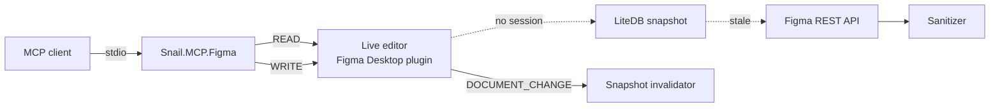

# Snail.MCP.Figma

A local MCP server that gives an AI agent 141 tools for reading and editing Figma.

Reads go through the **live Figma Desktop plugin** — no REST quota spent and unsaved edits visible — or
through the **REST API** behind a LiteDB snapshot cache and a sanitizer that keeps the raw Figma JSON out of
the model context. Writes go through the plugin only: nodes, variables, components, FigJam and Slides.



## Quick start

Install the server as a .NET tool (.NET 10 SDK required):

```bash
dotnet tool install -g Snail.MCP.Figma
```

Register the command with your MCP client:

```json
{
  "mcpServers": {
    "s3l-mcp-figma": {
      "command": "s3l-mcp-figma",
      "env": {
        "SNAIL_MCP_FIGMA_ACCESS_TOKEN": "figd_..."
      }
    }
  }
}
```

Then import the bundled plugin into Figma Desktop once — **Plugins → Development → Import plugin from
manifest…**, picking `manifest.json` from `~/.s3l-mcp-figma/plugin` — and run **Snail Bridge** in the file
you work in.

The token is needed by the REST channel only — version history, comments, other teams' libraries and files
that are not open in the desktop app. Everything else works through the plugin without a token.

Step-by-step instructions for every client, the token scopes, updating and uninstalling:
[Installation](installation.md).

## Where to go next

- [Installation](installation.md) — prerequisites, the three ways to install, client-by-client registration, verification.
- [Tools](tools/index.md) — all 141 tools with parameters and JSON schemas, generated from the server itself.
- [Architecture](architecture.md) — the two channels, snapshots, the quota circuit breaker.
- [Configuration](configuration.md) — environment variables and the optional settings file.
- [Plugin setup](plugin-setup.md) — installing the Figma Desktop bridge.
- [Troubleshooting](troubleshooting.md) — what to do when a tool answers "the plugin is not connected".

## Licences

The server is MIT. The bundled Figma extension in `plugin/` carries third-party code under the same
licence — the notices travel with it in `THIRD-PARTY-NOTICES.md`.
